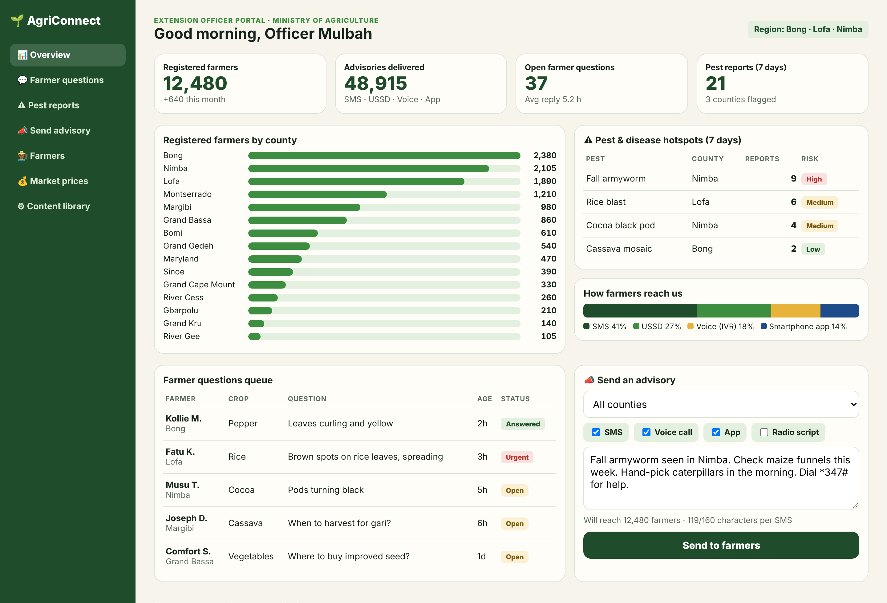

# 🌱 AgriConnect Liberia — Agriculture e-Advisory Platform

**RETRAP AgTech Innovation Hackathon 2026 · Group 10**

Expert farming advice for every Liberian farmer, on any phone, in their language, even offline.

## Try the prototype
No install or build is needed. Open these files in any browser:

| Page | What it shows |
|---|---|
| [`prototype/index.html`](prototype/index.html) | Farmer app: home, crop calendar, Pest Doctor, market prices, Ask an Expert, weather, agro-dealers |
| [`prototype/ussd.html`](prototype/ussd.html) | USSD simulator for basic phones: type `*347#` and press SEND |
| [`prototype/dashboard.html`](prototype/dashboard.html) | Extension officer dashboard: county stats, pest hotspots, question queue, send advisory |

For offline mode (service worker), serve the folder instead: `cd prototype && python3 -m http.server 8000`, then open http://localhost:8000.

Useful links: `index.html?screen=market` opens a given screen (`home`, `guide`, `pest`, `market`, `ask`, `weather`, `dealers`). `index.html?demo=diagnosis` shows a Pest Doctor result.

> All prices, counts and forecasts in the prototype are **sample data**.

## Pre-work documents
1. [Frame the problem](docs/01-problem-framing.md)
2. [Talk to real users: interview guide & notes](docs/02-user-interviews.md)
3. [Team roles & tools](docs/03-team-and-tools.md)
- [Full platform blueprint](docs/blueprint.md)
- [Screenshots](docs/screenshots/)

## Screens
| Farmer home | Pest Doctor | USSD |
|---|---|---|
|  |  |  |

