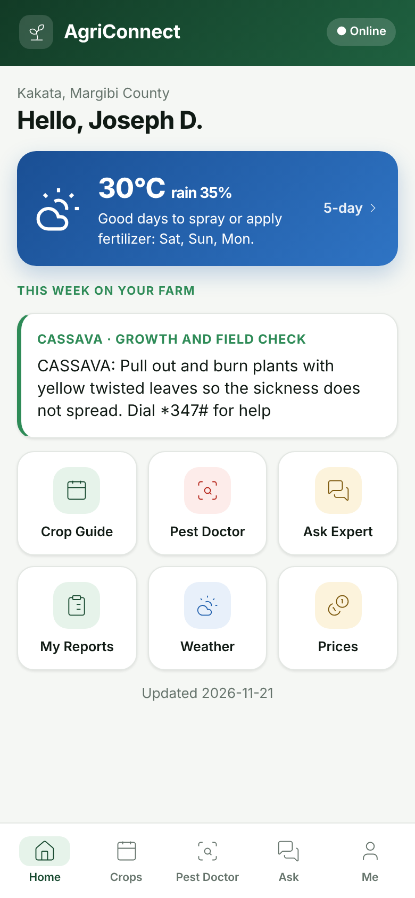
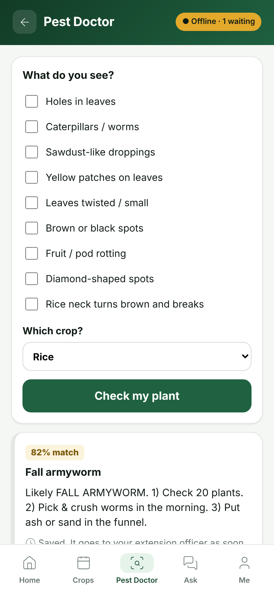
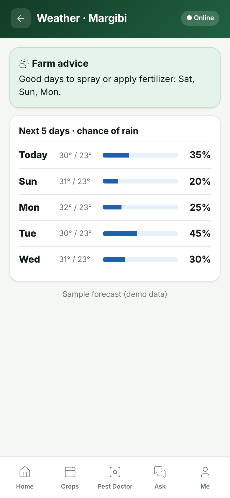
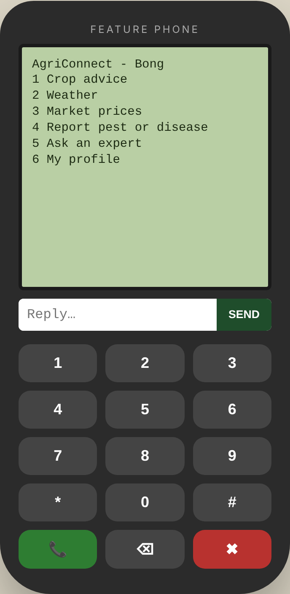
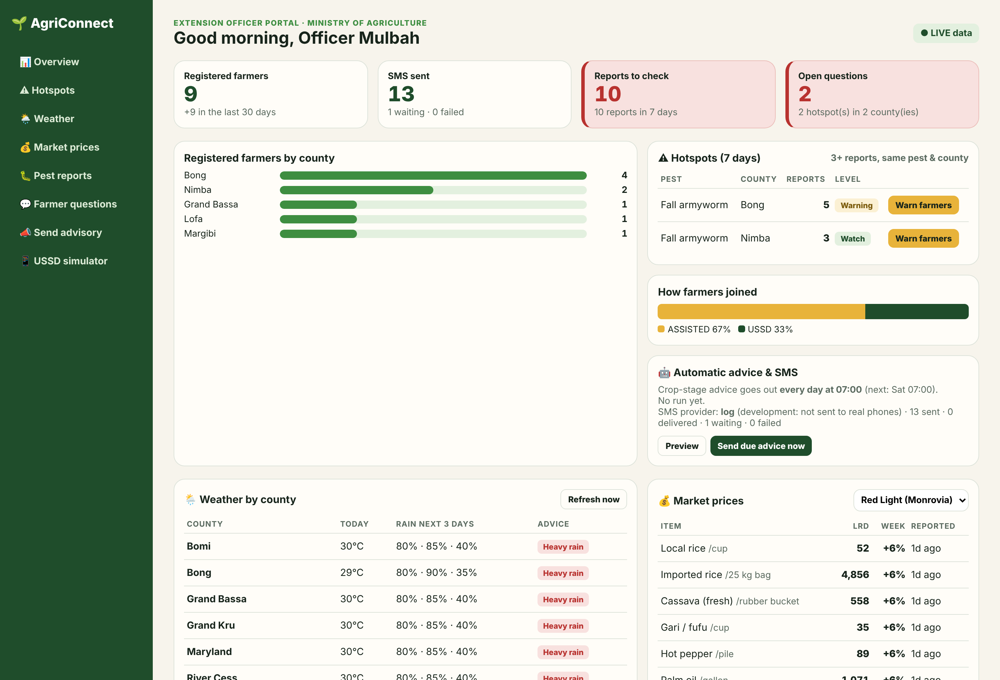

# 🌱 AgriConnect Liberia — Agriculture e-Advisory Platform

**RETRAP AgTech Innovation Hackathon 2026 · Group 10**

Expert farming advice for every Liberian farmer, on any phone, in their language, even offline.

## Try the prototype
No install or build is needed. Open these files in any browser:

| Page | What it shows |
|---|---|
| [`prototype/index.html`](prototype/index.html) | Farmer app: home, crop calendar, Pest Doctor, market prices, Ask an Expert, weather, agro-dealers |
| [`prototype/ussd.html`](prototype/ussd.html) | USSD simulator for basic phones: type `*347#` and press SEND |
| [`prototype/dashboard.html`](prototype/dashboard.html) | Extension officer dashboard: county stats, pest hotspots, question queue, send advisory |

For offline mode (service worker), serve the folder instead: `cd prototype && python3 -m http.server 8000`, then open http://localhost:8000.

Useful links: `index.html?screen=market` opens a given screen (`home`, `guide`, `pest`, `market`, `ask`, `weather`, `dealers`). `index.html?demo=diagnosis` shows a Pest Doctor result.

> All prices, counts and forecasts in the prototype are **sample data**.

## Run the platform (all 6 build steps done)
```bash
cd services/api
npm install
npm test        # 170 tests (also run on PostgreSQL in CI)
npm run seed    # demo farmers
npm run dev
```
| Open | What |
|---|---|
| http://localhost:3000/app/ | **Farmer app**: sign in with an SMS code, advice, weather, prices, Pest Doctor; works offline |
| http://localhost:3000/prototype/ussd.html | Basic phone `*347#` simulator with SMS inbox |
| http://localhost:3000/prototype/dashboard.html | Extension officer dashboard (log in: see the demo staff accounts printed by `npm run seed`) |

The USSD simulator and the officer dashboard (`/prototype/dashboard.html`) go **LIVE** when the API is running: register farmers on `*347#`, report pests, watch the hotspot appear on the dashboard, then warn farmers and see the SMS arrive.
Full guide: [docs/dev-setup.md](docs/dev-setup.md). Needs Node.js 22.13 or newer; no database to install.

## Put it on a server
Docker + PostgreSQL + automatic HTTPS + daily checked backups: see **[docs/deploy.md](docs/deploy.md)**.
```bash
cd deploy && cp .env.example .env   # set DOMAIN, POSTGRES_PASSWORD etc.
docker compose up -d --build
docker compose exec api npm run create-admin -- you@example.org "Your Name"
```

## Pre-work documents
1. [Frame the problem](docs/01-problem-framing.md)
2. [Talk to real users: interview guide & notes](docs/02-user-interviews.md)
3. [Team roles & tools](docs/03-team-and-tools.md)
- [Full platform blueprint (v2)](docs/blueprint.md): principles, user journeys, MVP scope, USSD design, architecture, API, data model, privacy, risks
- [Plan to build the platform](docs/build-plan.md): 5 phases, hackathon schedule, 6 sprints, pilot, exit criteria
- [Product backlog](docs/backlog.md): user stories with priority and acceptance criteria
- [Screenshots](docs/screenshots/)

## Screens (the working platform, demo data)
| Farmer app: home | Pest Doctor (offline) | Weather | Basic phone `*347#` |
|---|---|---|---|
|  |  |  |  |



More in [docs/screenshots/platform](docs/screenshots/platform). The original design mock-ups are in [docs/screenshots](docs/screenshots).
